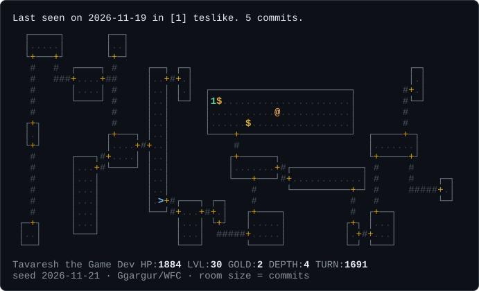

## Hi, I'm Tavaresh 👋

Game dev from Brazil 🇧🇷. I mostly work with Unity and C#, and lately I've been playing with Rust, Bevy and procedural generation.

🇧🇷 Leia em português

 
Dev de jogos do Brasil. Trabalho principalmente com Unity e C#, e ultimamente tenho brincado com Rust, Bevy e geração procedural.

  
  
  
  
  

### Dungeon of Ggargur

<picture>
  <source media="(prefers-color-scheme: dark)" srcset="https://raw.githubusercontent.com/Ggargur/Ggargur/output/dungeon-dark.svg" />
  <source media="(prefers-color-scheme: light)" srcset="https://raw.githubusercontent.com/Ggargur/Ggargur/output/dungeon-light.svg" />
  
</picture>

<!-- dungeon:start -->
`1` [portfolio](https://github.com/Ggargur/portfolio) ×8
<!-- dungeon:end -->

A new map every day, drawn by my <a href="https://github.com/Ggargur/WFC">WFC</a> port from the repos I touched last. Games on itch.io: <a href="https://farbeyondstudios.itch.io/kitty-rhythm-td">Kitty Rhythm TD</a> · <a href="https://tavareschan.itch.io/wild-magic">Wild Magic</a>

### Inventory

<table>
  <tr>
    <td align="center" width="96"> <code>a</code> C# <b>equipped</b></td>
    <td align="center" width="96"> <code>b</code> Unity <b>equipped</b></td>
    <td align="center" width="96"> <code>c</code> Rust <b>equipped</b></td>
    <td align="center" width="96"> <code>d</code> Bevy &nbsp;</td>
    <td align="center" width="96"> <code>e</code> Godot &nbsp;</td>
  </tr>
  <tr>
    <td align="center" width="96"> <code>f</code> C++</td>
    <td align="center" width="96"> <code>g</code> Python</td>
    <td align="center" width="96"> <code>h</code> Vue</td>
    <td align="center" width="96"> <code>i</code> Linux</td>
    <td align="center" width="96"> <code>j</code> Git</td>
  </tr>
</table>
